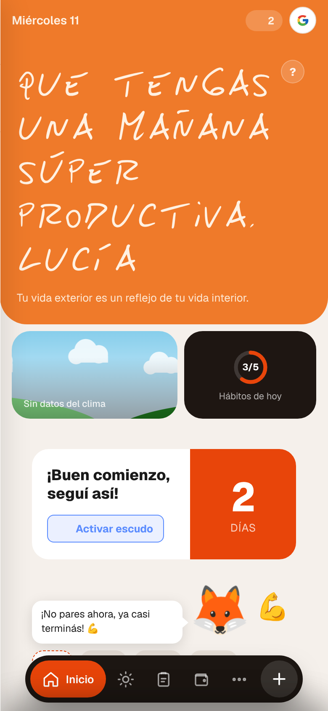
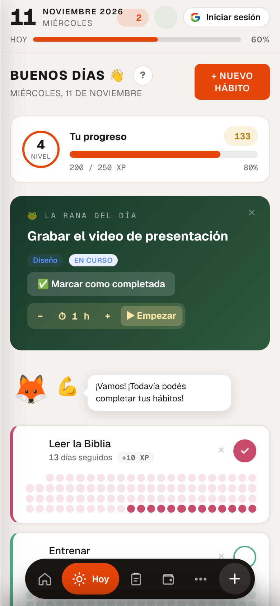
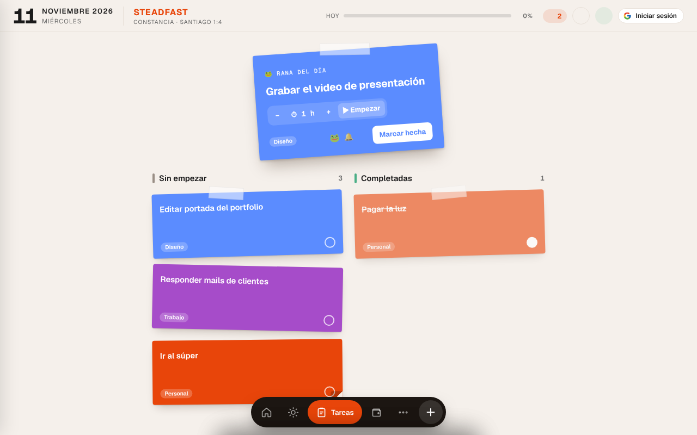

  

<h1 align="center">Steadfast</h1>

<i>"Así que dejen que crezca, pues una vez que su constancia se haya desarrollado plenamente, serán perfectos y completos, y no les faltará nada."</i> Santiago 1:4 (NTV)

  <a href="https://agustin23-gif.github.io/sistema-tracy/"><b>Abrir la app</b></a> ·
  <a href="#cómo-instalarla-en-el-iphone">Instalarla en el iPhone</a> ·
  <a href="#ideas-y-errores">Dejar una idea o avisar de un error</a>

---

Steadfast es una app gratuita para sostener tus hábitos, tus tareas del día y tus finanzas personales. Funciona en el celular y en la computadora, no hace falta crear una cuenta y es de código abierto.

  
  &nbsp;
  

## Por qué existe

En Santiago 1 aparece la palabra griega *hupomoné*, que se traduce como "constancia". Literalmente significa **permanecer debajo de la carga** (*hupo*, debajo; *meno*, permanecer). Pasa lo mismo que en el gimnasio: el músculo no crece esquivando el peso, crece quedándose debajo de él.

Steadfast nació como una herramienta personal para entrenar esa constancia todos los días. El nombre es la forma en que la versión inglesa ESV traduce esa palabra. El logo es una columna, por Apocalipsis 3:12: algo que no se mueve y sostiene peso.

## Qué hace

- **Hábitos y rachas.** Marcás lo que cumpliste hoy y ves cuántos días seguidos llevás. Cada hábito pertenece a un área de tu vida (mente, cuerpo, personal), y cada área sube de nivel.
- **La Rana del día.** Cada mañana elegís vos la tarea más difícil y la hacés primero, con un temporizador que sigue aunque bloquees el teléfono. La idea viene de Brian Tracy.
- **Tareas.** Las ves en una lista o como notas adhesivas, y podés ponerles etiquetas de color y recordatorios que van directo al Calendario del iPhone o a Google Calendar.
- **Finanzas.** Anotás gastos e ingresos con un teclado rápido y ves cuánto te queda para gastar este mes. También tiene pagos fijos y lo que te deben ("Por cobrar"), pensado para freelancers.
- **Premios.** Cada hábito y cada tarea te dan fichas que canjeás por recompensas que vos elegís.
- **Reloj del día.** Ves en qué se te va el tiempo, en bloques de colores.
- **Modo oscuro**, y una guía corta la primera vez que entrás a cada sección.

  

## Cómo usarla

Entrá a **[agustin23-gif.github.io/sistema-tracy](https://agustin23-gif.github.io/sistema-tracy/)** desde cualquier navegador. Eso es todo: no se descarga nada de una tienda de apps.

### Cómo instalarla en el iPhone

1. Abrí el link en **Safari**.
2. Tocá el botón **Compartir** (el cuadrado con la flecha hacia arriba).
3. Elegí **Agregar a inicio**.

Queda como una app más en tu pantalla de inicio, con su ícono. En Android, desde Chrome, es el menú ⋮ y después "Instalar app".

### Tus datos

- **Sin cuenta:** todo se guarda solo en tu dispositivo. Nadie más lo ve.
- **Con tu cuenta de Google** (botón "Iniciar sesión"): se guarda en la nube, asociado a tu cuenta, para que la uses en el celular y en la computadora a la vez.

## Ideas y errores

La app está viva y quiero mejorarla con lo que te sirva a vos.

- **Si tenés cuenta de GitHub:** abrí un [Issue](https://github.com/Agustin23-gif/sistema-tracy/issues/new) contando qué pasó o qué se te ocurre.
- **Si no:** escribime por Instagram a [@agustin_lezcano](https://www.instagram.com/agustin_lezcano/).

Si sabés programar y querés proponer un cambio, la app entera está en un solo archivo, [`tracy-system.html`](tracy-system.html): se abre en el navegador sin instalar nada. Respetá el estilo, que es simple y minimalista, siempre en naranja (`#E8450A`), con la excepción de Finanzas, que va en verde.

## Cómo está hecha

Es HTML, CSS y JavaScript en un solo archivo, sin frameworks. Usa [Firebase](https://firebase.google.com/) para iniciar sesión con Google y sincronizar, y un service worker para que funcione sin conexión. La diseñé y la fui construyendo conversando con una IA ([Claude Code](https://claude.com/claude-code)).

## Licencia

[MIT](LICENSE), © 2026 Agustin Lezcano. Podés usarla, copiarla y modificarla libremente, siempre que mantengas el aviso de autoría.
